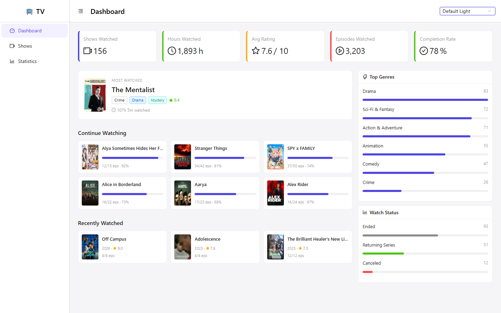
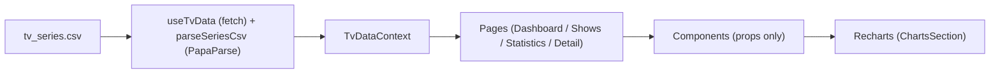

# TV Dashboard

[](https://github.com/SanjayJoshi116/tv-dash/actions/workflows/ci.yml)

A personal TV watch-history dashboard built with React, TypeScript, and Ant Design. It turns a `tv_series.csv` file — built and enriched with [TMDB](https://www.themoviedb.org/documentation/api) metadata (posters, cast, ratings, keywords) — into a filterable show library and a 14-chart analytics view. Fully responsive, from a 320px phone screen up to a capped/centered 1600px desktop layout.

**Live demo:** not currently deployed.

## Screenshots

| Dashboard | Shows |
|---|---|
|  |  |

| Show Detail | Statistics |
|---|---|
|  |  |

| Mobile | Default Light theme |
|---|---|
|  |  |

## Highlights

- 14 Recharts analytics grouped into 4 tabs (Overview / Watch Time / Ratings / People & Networks), all `useMemo`-ized
- 3 themes (Default Dark, Default Light, Dracula), zero hardcoded dark/light colors
- Fully responsive: icon-rail collapsible sidebar on desktop, fixed auto-hiding bottom nav bar on phone, 2–8 column poster grid, capped/centered content column
- Debounced search + memoized filter pipeline, idle-prefetched route chunks
- Standalone TMDB-powered CSV generator (`series-search.py`) with incremental updates

## Features

- **Dashboard** — 5-card stat row (icon badge + value-driven colors), 3-card Highlights row (Most Watched/Top Rated/Newest Release), Continue Watching (with "New eps" flag on returning shows), Recently Watched, Top Genres/Watch Status/Ratings sidebar tabs, Explore More CTA row, empty state for a fresh CSV
- **Analytics** — 14 charts across 4 tabs: genre distribution, status breakdown, language breakdown, age rating distribution, rating histogram, shows by year, top networks, top 10 by watch time, watch time by decade/year, rating vs popularity scatter, completion by genre, seasons watched depth, top actors/creators
- **Filter & search** — search by title, actor, keyword, genre, creator, or network; filter by genre and status; sort by recently watched, rating, popularity, year, watch time; filters persist across sessions (debounced); result-count row with removable filter chips and a one-click reset
- **Poster grid** — responsive card grid (2–8 columns) with TMDB poster images, rating badges, genre tags, and pagination
- **Responsive layout** — icon-rail collapsible sidebar on desktop (collapse trigger at the bottom of the sidebar itself); on phone, the sidebar is replaced entirely by a fixed bottom nav bar that auto-hides on scroll; capped/centered content column; idle-prefetched route chunks
- **Show detail** — full page per show: expandable overview, vote count, formatted air dates, cast, networks, creators, keywords, watch history with icon-annotated season tracker, graceful fallback for missing/broken poster images, and a proper empty state for an invalid show ID; "Show more" appears only when the overview is actually truncated
- **3 themes** — Default Dark, Default Light, Dracula; persists across sessions
- **Accessibility** — labeled form fields (`aria-label`/`id` on all filters), keyboard-operable cards and list items across the Dashboard (`role="button"`, Enter/Space handlers), hover tooltips on the collapsed sidebar
- **Resilient routing** — 404 page for unknown URLs; per-route error boundary keeps the layout up if a page crashes or a lazy chunk fails to load; every navigation starts at the top of the page; trailing-slash URLs resolve to the right nav item

## Architecture & Data Flow

Single-page app, no backend. `tv_series.csv` is fetched at runtime, parsed once, and flows one-directionally into every page and chart:



Pages read from `TvDataContext` via `useTvDataContext()`; components receive data as props and don't touch context directly. All aggregation (stats, chart data) lives in `src/utils/derive.ts` and is `useMemo`-ized against the raw CSV array.

## Getting Started

```bash
npm install
npm run dev
```

Open `http://localhost:5173`. The dev server also binds `0.0.0.0`, so it's reachable from other devices on the same network via the Network URL Vite prints alongside the local one — handy for checking the mobile layout on an actual phone.

## Production Build

```bash
npm run build      # outputs to dist/
npm run preview    # preview the production build locally
```

To deploy, serve the contents of `dist/` from any static host (Vercel, Netlify, GitHub Pages, nginx, etc.).

## Data

Place your `tv_series.csv` in the `public/` directory. The app fetches it at runtime — swap it out without rebuilding. The file is not included in this repo; see the column schema below to create your own.

> **Note:** The last rows in the CSV are treated as most recently watched (no timestamp field).

Required columns: `TV ID`, `Name`, `Vote Average`, `Genres`, `Status` — a file missing any of them fails to load. A row with the wrong number of fields or a blank/invalid/duplicate `TV ID` is skipped rather than failing the whole file — a warning banner above every page lists skipped rows (full list in the console). A broken quote fails the load (it would otherwise swallow every following row), and so does every row being skipped. An empty file shows the Dashboard empty state. CSV values are only ever rendered as text or image sources (never raw HTML or links).

### Expected columns

| Column | Type | Notes |
|--------|------|-------|
| TV ID | number | Unique positive integer; rows without one, or repeating an earlier ID, are skipped |
| Name | string | |
| Language | string | ISO code, e.g. `ja`; blank or `N/A` = unknown |
| Seasons | number | Blank or `0` = unknown (shown as `–`) |
| Episode Runtime | number \| `N/A` | Minutes |
| First Air Year | number | Blank or `0` = unknown (shown as `–`, sorted last) |
| Genres | string | Comma-separated |
| Creators | string | Comma-separated |
| Networks | string | Comma-separated |
| Status | string | TMDB status: `Returning Series`, `Ended`, `Canceled`, `In Production`, `Planned`, `Pilot` |
| Total Episodes | number | |
| Last Episode Air Date | date | `YYYY-MM-DD` |
| Popularity | number | |
| Vote Count | number | |
| Vote Average | number | 0–10 scale; blank or `0` = unrated (hidden, sorted last) |
| Actors/Actresses | string | Comma-separated |
| Keywords/Tags | string | Comma-separated |
| First Air Date | date | `YYYY-MM-DD` |
| Overview | string | |
| Tagline | string | |
| Poster URL | string | Full URL to poster image |
| Age Rating | string | e.g. `TV-14`, `TV-MA`; blank or `N/A` = unknown |
| Seasons Watched | string | Comma-separated season numbers (duplicates and non-positive values ignored) |
| Episodes Watched | number | |
| Total Runtime Watched (min) | number | |

## Generating the CSV

`series-search.py` is a Tkinter desktop app that builds and maintains `tv_series.csv` by querying the [TMDB API](https://www.themoviedb.org/documentation/api). It updates incrementally — re-adding a show with newly watched seasons updates its existing row instead of recreating the whole file. Network calls run in background threads, so the window stays responsive, and the API key is stripped from any error message. Writes are safe: a rewrite goes through a temp file (never a half-written CSV), a file re-saved by Excel (UTF-8 BOM) still works, and any save error is shown in a dialog.

**Requirements:**

```bash
pip install requests
```

Set your TMDB API key as an env var (get one free at [themoviedb.org](https://www.themoviedb.org/documentation/api); see `.env.example`):

```bash
export TMDB_API_KEY=your_key_here   # Windows: set TMDB_API_KEY=your_key_here
```

**Run:**

```bash
python series-search.py
```

**How it works:**

1. Search a TV series by name — results pulled from TMDB
2. Select a show from the results table
3. Pick which seasons you watched in the season panel
4. Click **Save to CSV** — appends a new row (or updates an existing one) in `public/tv_series.csv`

**Notes:**
- Re-adding a show with new seasons updates the existing row rather than duplicating it.
- Last row = most recently watched — row order is watch order (no timestamp field).
- Writes straight to `public/tv_series.csv` next to the script, whatever folder you run it from — no copy step.
- Unknown values are written as blank (older rows may contain `N/A`; the dashboard treats both as unknown).

## Stack

- [React 18.3](https://react.dev) + [TypeScript 5.4](https://www.typescriptlang.org)
- [Ant Design 5.25+](https://ant.design) — UI components and theming
- [Recharts 2.12](https://recharts.org) — charts
- [PapaParse 5.4](https://www.papaparse.com) — CSV parsing
- [React Router 7.18](https://reactrouter.com) — routing
- [Vite 5.3](https://vitejs.dev) — build tool

## Testing

[Vitest](https://vitest.dev) + [Testing Library](https://testing-library.com). Tests run in a node environment by default; DOM tests opt into jsdom with a `// @vitest-environment jsdom` first line (see `useTvData.test.ts`). Four suites, 80 tests:

- `src/hooks/useTvData.test.ts` — fetch lifecycle (loading/success/error/retry, superseded response, timeout)
- `src/utils/parseSeriesCsv.test.ts` — CSV parsing rules (row mapping, skipped rows, fatal errors, numeric fallbacks); shared CSV fixtures in `parseSeriesCsv.fixture.ts`
- `src/utils/derive.test.ts` — every aggregation function in `derive.ts`
- `src/constants/ui.test.ts` — color helpers and status ordering

```bash
npm run test        # run once
npm run test:watch  # watch mode
```

**Browser e2e** — [Playwright](https://playwright.dev) suite in `e2e/` (dashboard, show detail, shows page, mobile bottom nav). It serves its own synthetic CSV (skipped rows, blank / `N/A` / fractional / huge values, broken posters) via route interception, so it never depends on your data; a separate smoke test checks the real `public/tv_series.csv` when present.

```bash
npx playwright install chromium   # once per machine
npm run e2e                       # starts the dev server on :5199 automatically
```

**CSV generator** — `scripts/test_series_search.py` imports `series-search.py` and drives its real Tk window with TMDB faked and a temp CSV (your CSV and API key are never used) — including checks that the window stays responsive while a request is slow. Needs a display, so it's local-only. `npm run test:gen` finds `python` / `py` / `python3` itself (`scripts/run-python.mjs`).

```bash
npm run test:gen
```

## Performance

- Search filter persistence is debounced (300ms) rather than writing to `localStorage` on every keystroke
- Route chunks (Shows/Statistics/Show Detail) are idle-prefetched after initial mount
- All Recharts `ResponsiveContainer`s use `debounce={200}` — avoids re-rendering on every animation frame during sidebar collapse
- `React.memo` on `ShowCard`, `ShowGrid`, `StatsBar`, `ChartsSection`; `useDeferredValue` on search input
- List thumbnails use `loading="lazy"` (the Show Detail hero image is intentionally excluded — it's above the fold)

## CI

[GitHub Actions](.github/workflows/ci.yml) runs on every push/PR to `main`: `npm run lint`, `npm run test`, `npm run build` (type-check + production bundle), and a separate `e2e` job (`npm run e2e` on Chromium; HTML report uploaded as an artifact on failure).

## Project Structure

```
src/
├── themes.ts                 # 3 theme definitions + Theme type
├── ThemeContext.tsx           # useTheme() hook
├── constants/
│   └── ui.ts                 # Shared colors, spacing, card style, status table + color helpers
├── context/
│   ├── TvDataContext.tsx     # TvDataProvider (wraps useTvData)
│   └── useTvDataContext.ts   # Context object + useTvDataContext() hook
├── hooks/
│   └── useTvData.ts          # CSV fetch hook (loading/error/refetch)
├── types/
│   ├── filters.ts             # Filters, SortKey (Shows page)
│   └── series.ts              # TvSeries interface (unknown = null), NameValue/NameCount
├── utils/
│   ├── a11y.ts                # activateOnKey (Enter/Space for role="button")
│   ├── derive.ts              # Stats and chart data helpers
│   ├── lookup.ts              # Own-key lookup for CSV-derived keys
│   ├── parseSeriesCsv.ts      # Pure CSV → TvSeries[] parsing + row validation
│   └── settings.ts            # localStorage persistence utility
├── components/
│   ├── AppLayout.tsx          # Sider + Header + Content shell
│   ├── BottomNav.tsx          # Mobile bottom nav (hides on scroll-down)
│   ├── ChartsSection.tsx      # 14 Recharts charts in 4 tabs
│   ├── CsvWarningBanner.tsx   # Dismissible banner for skipped CSV rows
│   ├── ErrorState.tsx         # Shared error alert with retry
│   ├── FilterBar.tsx          # Search, genre, status, sort controls
│   ├── LoadingState.tsx       # Shared loading spinner
│   ├── PosterThumb.tsx        # Poster image + placeholder fallback (empty or 404 URL)
│   ├── RouteErrorBoundary.tsx # Catches page render / chunk-load errors
│   ├── ShowCard.tsx           # Individual show card
│   ├── ShowGrid.tsx           # Responsive CSS-grid of ShowCards
│   ├── StatCard.tsx           # Shared stat tile (Dashboard, StatsBar, Show Detail)
│   ├── StatsBar.tsx           # Row of stat cards
│   └── ThemeToggle.tsx        # Theme selector
└── pages/
    ├── DashboardPage.tsx      # Overview: stats, highlights, continue/recently watched
    ├── NotFoundPage.tsx       # Catch-all 404 route
    ├── ShowDetailPage.tsx     # Full show detail
    ├── ShowsPage.tsx          # Filtered, paginated show grid
    └── StatisticsPage.tsx     # StatsBar + ChartsSection
```

## Scripts

| Script | Description |
|--------|-------------|
| `npm run dev` | Start dev server |
| `npm run build` | Type-check + production build |
| `npm run preview` | Preview production build |
| `npm run test` | Run unit tests (Vitest) |
| `npm run e2e` | Run browser e2e tests (Playwright) |
| `npm run test:gen` | Check `series-search.py` (Tk, local only) |
| `npm run lint` | ESLint |
| `npm run format` | Prettier |

## Future Improvements

Ideas, not commitments — the full ranked list (P1 / P2 / P3 per module) is in [IDEAS.md](IDEAS.md), known bugs in [BUG_BACKLOG.md](BUG_BACKLOG.md). Highlights:

- Shows filters + page in the URL (Back from a show keeps your place; shareable filtered views; clickable tags / chart drill-down)
- Watch-history timestamps (a `Last Watched` column — row order is currently the only signal for "recently watched")
- Personal layer on top of the CSV: favorites, your own rating, notes
- Generator: "Refresh all" for stale TMDB metadata, and re-watched shows moved to the end of the CSV
- Load your own CSV in the browser (local only) and CSV export

## License

[MIT](LICENSE)
