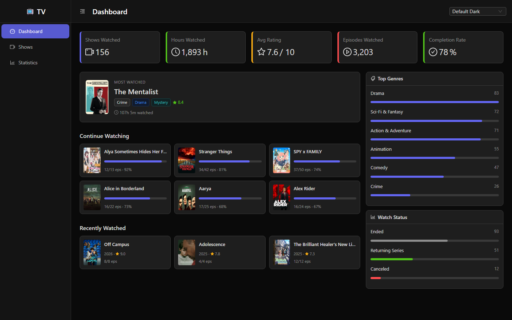
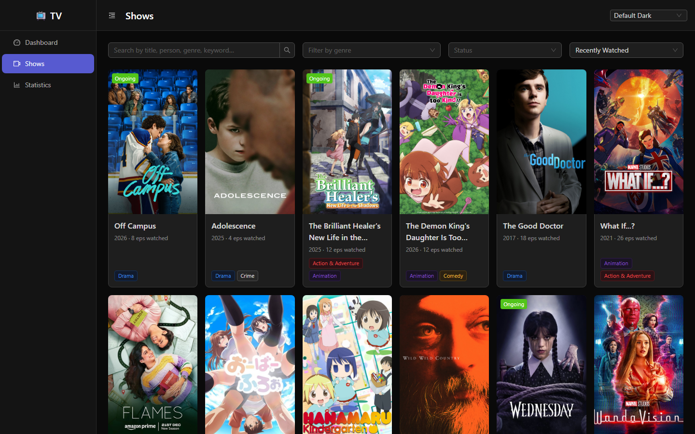
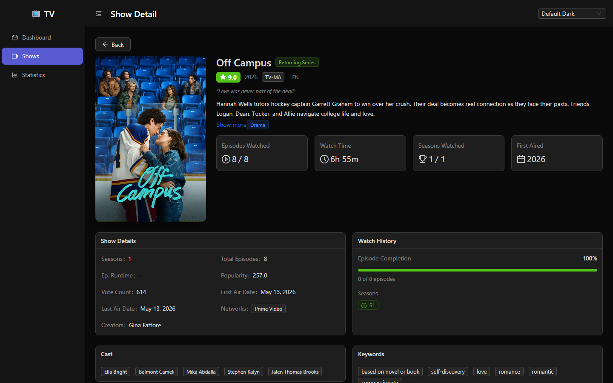
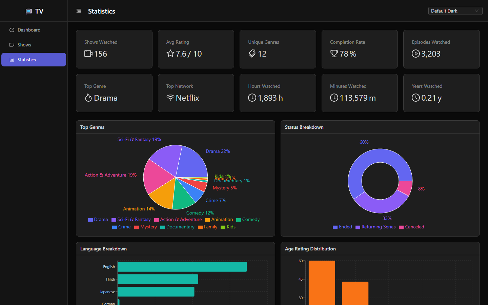
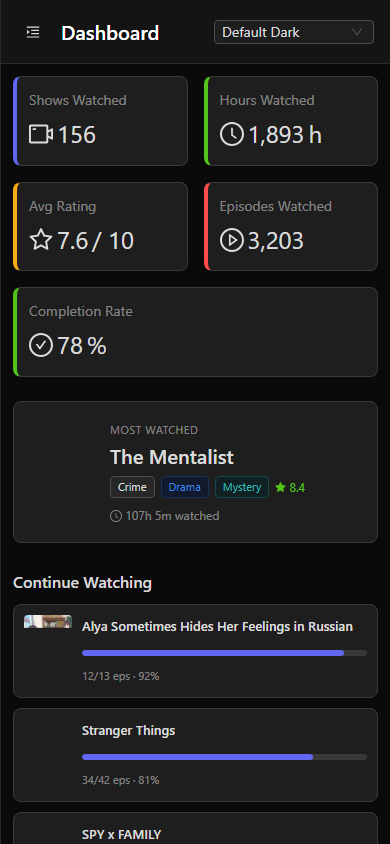
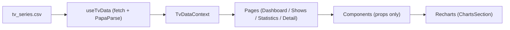

# TV Dashboard

[](https://github.com/SanjayJoshi116/tv-dash/actions/workflows/ci.yml)

A personal TV watch-history dashboard built with React, TypeScript, and Ant Design. It turns a `tv_series.csv` file — built and enriched with [TMDB](https://www.themoviedb.org/documentation/api) metadata (posters, cast, ratings, keywords) — into a filterable show library and a 14-chart analytics view. Fully responsive, from a 320px phone screen up to a capped/centered 1600px desktop layout.

**Live demo:** not currently deployed.

## Screenshots

| Dashboard | Shows |
|---|---|
|  |  |

| Show Detail | Statistics |
|---|---|
|  |  |

| Mobile | Default Light theme |
|---|---|
|  |  |

## Highlights

- 14 always-visible Recharts analytics, all `useMemo`-ized
- 3 themes (Default Dark, Default Light, Dracula), zero hardcoded dark/light colors
- Fully responsive: icon-rail collapsible sidebar, 2–8 column poster grid, capped/centered content column
- Debounced search + memoized filter pipeline, idle-prefetched route chunks
- Standalone TMDB-powered CSV generator (`series-search.py`) with incremental updates

## Features

- **Dashboard** — 5-card stat row (value-driven colors), "Most Watched" spotlight, Continue Watching, Recently Watched, Top Genres/Watch Status sidebar, empty state for a fresh CSV
- **Analytics** — 14 charts always visible: genre distribution, status breakdown, language breakdown, age rating distribution, rating histogram, shows by year, top networks, top 10 by watch time, watch time by decade/year, rating vs popularity scatter, completion by genre, seasons watched depth, top actors/creators
- **Filter & search** — search by title, actor, keyword, genre, creator, or network; filter by genre and status; sort by recently watched, rating, popularity, year, watch time; filters persist across sessions (debounced)
- **Poster grid** — responsive card grid (2–8 columns) with TMDB poster images, rating badges, genre tags, and pagination
- **Responsive layout** — collapsible sidebar (icon-rail on manual collapse, full-hide below `lg` breakpoint), header-based collapse trigger, capped/centered content column, idle-prefetched route chunks
- **Show detail** — full page per show: expandable overview, vote count, formatted air dates, cast, networks, creators, keywords, watch history with icon-annotated season tracker
- **3 themes** — Default Dark, Default Light, Dracula; persists across sessions
- **Accessibility** — labeled form fields (`aria-label`/`id` on all filters), keyboard-operable list items (`role="button"`, Enter/Space handlers), hover tooltips on the collapsed sidebar

## Architecture & Data Flow

Single-page app, no backend. `tv_series.csv` is fetched at runtime, parsed once, and flows one-directionally into every page and chart:



Pages read from `TvDataContext` via `useTvDataContext()`; components receive data as props and don't touch context directly. All aggregation (stats, chart data) lives in `src/utils/derive.ts` and is `useMemo`-ized against the raw CSV array.

## Getting Started

```bash
npm install
npm run dev
```

Open `http://localhost:5173`.

## Production Build

```bash
npm run build      # outputs to dist/
npm run preview    # preview the production build locally
```

To deploy, serve the contents of `dist/` from any static host (Vercel, Netlify, GitHub Pages, nginx, etc.).

## Data

Place your `tv_series.csv` in the `public/` directory. The app fetches it at runtime — swap it out without rebuilding. The file is not included in this repo; see the column schema below to create your own.

> **Note:** The last rows in the CSV are treated as most recently watched (no timestamp field).

### Expected columns

| Column | Type | Notes |
|--------|------|-------|
| TV ID | number | Unique identifier |
| Name | string | |
| Language | string | ISO code, e.g. `ja` |
| Seasons | number | |
| Episode Runtime | number \| `N/A` | Minutes |
| First Air Year | number | |
| Genres | string | Comma-separated |
| Creators | string | Comma-separated |
| Networks | string | Comma-separated |
| Status | string | `Ended`, `Returning Series`, or `Canceled` |
| Total Episodes | number | |
| Last Episode Air Date | date | `YYYY-MM-DD` |
| Popularity | number | |
| Vote Count | number | |
| Vote Average | number | 0–10 scale |
| Actors/Actresses | string | Comma-separated |
| Keywords/Tags | string | Comma-separated |
| First Air Date | date | `YYYY-MM-DD` |
| Overview | string | |
| Tagline | string | |
| Poster URL | string | Full URL to poster image |
| Age Rating | string | e.g. `TV-14`, `TV-MA` |
| Seasons Watched | string | Comma-separated season numbers |
| Episodes Watched | number | |
| Total Runtime Watched (min) | number | |

## Generating the CSV

`series-search.py` is a Tkinter desktop app that builds and maintains `tv_series.csv` by querying the [TMDB API](https://www.themoviedb.org/documentation/api). It updates incrementally — re-adding a show with newly watched seasons updates its existing row instead of recreating the whole file.

**Requirements:**

```bash
pip install requests
```

Set your TMDB API key as an env var (get one free at [themoviedb.org](https://www.themoviedb.org/documentation/api); see `.env.example`):

```bash
export TMDB_API_KEY=your_key_here   # Windows: set TMDB_API_KEY=your_key_here
```

**Run:**

```bash
python series-search.py
```

**How it works:**

1. Search a TV series by name — results pulled from TMDB
2. Select a show from the results table
3. Pick which seasons you watched in the season panel
4. Click **Save to CSV** — appends a new row (or updates an existing one) in `tv_series.csv`

**Notes:**
- Re-adding a show with new seasons updates the existing row rather than duplicating it.
- Last row = most recently watched — row order is watch order (no timestamp field).
- Move the output `tv_series.csv` to `public/` before running the dashboard.

## Stack

- [React 18.3](https://react.dev) + [TypeScript 5.4](https://www.typescriptlang.org)
- [Ant Design 5.17](https://ant.design) — UI components and theming
- [Recharts 2.12](https://recharts.org) — charts
- [PapaParse 5.4](https://www.papaparse.com) — CSV parsing
- [React Router 7.18](https://reactrouter.com) — routing
- [Vite 5.3](https://vitejs.dev) — build tool

## Testing

[Vitest](https://vitest.dev) + [Testing Library](https://testing-library.com) + jsdom. Two suites, 44 tests:

- `src/hooks/useTvData.test.ts` — fetch lifecycle (loading/success/error/retry)
- `src/utils/derive.test.ts` — every aggregation function in `derive.ts`

```bash
npm run test        # run once
npm run test:watch  # watch mode
```

## Performance

- Search filter persistence is debounced (300ms) rather than writing to `localStorage` on every keystroke
- Route chunks (Shows/Statistics/Show Detail) are idle-prefetched after initial mount
- All Recharts `ResponsiveContainer`s use `debounce={200}` — avoids re-rendering on every animation frame during sidebar collapse
- `React.memo` on `ShowCard`, `ShowGrid`, `StatsBar`, `ChartsSection`; `useDeferredValue` on search input
- List thumbnails use `loading="lazy"` (the Show Detail hero image is intentionally excluded — it's above the fold)

## CI

[GitHub Actions](.github/workflows/ci.yml) runs on every push/PR to `main`: `npm run lint`, `npm run test`, `npm run build` (type-check + production bundle).

## Project Structure

```
src/
├── themes.ts                 # 3 theme definitions + Theme type
├── ThemeContext.tsx           # useTheme() hook
├── constants/
│   └── ui.ts                 # Shared colors, spacing, and color functions
├── context/
│   └── TvDataContext.tsx     # CSV data context
├── hooks/
│   └── useTvData.ts          # CSV fetch + parse hook
├── types/
│   └── series.ts              # TvSeries interface
├── utils/
│   ├── derive.ts              # Stats and chart data helpers
│   └── settings.ts            # localStorage persistence utility
├── components/
│   ├── AppLayout.tsx          # Sider + Header + Content shell
│   ├── ChartsSection.tsx      # All Recharts charts (always visible, no collapse)
│   ├── ErrorState.tsx         # Shared error alert with retry
│   ├── FilterBar.tsx          # Search, genre, status, sort controls
│   ├── LoadingState.tsx       # Shared loading spinner
│   ├── ShowCard.tsx           # Individual show card
│   ├── ShowGrid.tsx           # Responsive CSS-grid of ShowCards
│   ├── StatsBar.tsx           # Row of stat cards
│   └── ThemeToggle.tsx        # Theme selector
└── pages/
    ├── DashboardPage.tsx      # Overview: stats, spotlight, continue/recently watched
    ├── ShowDetailPage.tsx     # Full show detail
    ├── ShowsPage.tsx          # Filtered, paginated show grid
    └── StatisticsPage.tsx     # StatsBar + ChartsSection
```

## Scripts

| Script | Description |
|--------|-------------|
| `npm run dev` | Start dev server |
| `npm run build` | Type-check + production build |
| `npm run preview` | Preview production build |
| `npm run test` | Run tests |
| `npm run lint` | ESLint |
| `npm run format` | Prettier |

## Future Improvements

Ideas, not commitments:

- Watch-history timestamps (currently row-order is the only signal for "recently watched")
- Import/export for `tv_series.csv`
- Optional cloud sync / multi-device support

## License

[MIT](LICENSE)
